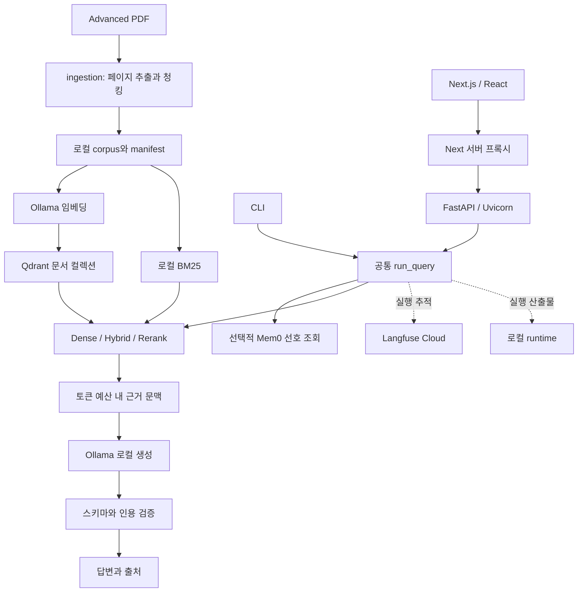

# 시스템 아키텍처

Advanced 해운 PDF를 검색해 원문 출처와 함께 답변하는 개발 검증용 RAG 시스템입니다. 설치와 실행은 [SETUP.md](SETUP.md), 코드 변경과 협업은 [DEVELOPER.md](DEVELOPER.md)를 참조합니다.

## 설계 원칙과 현재 범위

- 모든 임베딩·생성·평가·기억 추출 추론은 로컬에서 실행합니다. 외부 LLM fallback은 허용하지 않습니다.
- Qdrant Cloud는 벡터 저장·검색, Langfuse Cloud는 추적에 사용합니다. 로컬 추론은 완전 오프라인을 뜻하지 않습니다.
- CLI·API·Web은 `backend/app/pipeline.py`의 `run_query()`를 공유합니다.
- 검색 원문과 평가 정답은 분리합니다. 생성 입력에 평가 정답이나 채점 기준을 추가하지 않습니다.
- 실행 설정·모델·문맥·출처를 기록하고, 개발 검증과 정식 평가를 구분합니다.
- 현재는 localhost 데모입니다. 서버 인증·역할 기반 접근 제어·세션 보안·Redis 전환은 후속 범위입니다.
- RTX 5060 8GB의 전체 코퍼스 정식 품질·VRAM·지연 검증 완료나 최고 검색 구성 선정을 주장하지 않습니다.

## 구성과 데이터 흐름

### 문서 처리

`ingestion.py`는 `data/advanced/**/documents/*.pdf`에서 AS001~AS120을 수집합니다. part별 원본 구조를 유지하고 페이지 텍스트·문서 ID·원본 해시를 보존합니다. 두 임베딩의 실제 tokenizer로 공통 청크 경계를 만들며 목표 600, overlap 100, 상한 1000 tokens를 사용합니다. PDF 추출 성공은 표의 단위·각주·행열 의미 보존까지 보장하지 않습니다.

`indexing.py`는 청크를 BGE·Qwen별 Qdrant 컬렉션에 적재합니다. 원본·청크·모델 digest·선택 범위·임베딩 문맥 설정을 fingerprint에 반영합니다. 결정적 UUID와 upsert, 로컬 체크포인트로 재개하며 완료한 색인은 `$RUNTIME_DIR/indexes/active_bge.json` 또는 `active_qwen.json`으로 선택합니다. BM25도 동일한 청크를 사용합니다.

### 질의 처리

1. 요청 스키마와 로컬 추론 정책을 확인하고 실행 식별자를 만듭니다.
2. 요청에서 켠 경우에만 사용자별 Mem0 선호를 조회합니다.
3. 질문 임베딩과 검색을 수행하고 최종 근거 문맥을 구성합니다.
4. 실제 생성 tokenizer로 프롬프트 예산을 확인합니다. 필요하면 낮은 순위 문맥을 제외하므로 최종 문맥은 4개보다 적을 수 있습니다.
5. 로컬 모델에서 구조화 답변을 생성합니다.
6. 스키마 및 실제 문맥의 `book_id/page/chunk_id`와 인용을 대조합니다. `answered`에는 출처가 필요합니다.
7. 응답·실제 messages·문맥·오류·usage를 runtime과 설정된 trace에 기록합니다.

응답 상태는 `answered`, `needs_clarification`, `abstained`입니다. 상태·문장·출처 검증은 의미상 정답 여부의 완전한 검증과 다릅니다.

## 모델과 검색 구성

| 역할 | 구현 |
| --- | --- |
| 임베딩 A | Ollama `bge-m3`, 1024차원 dense |
| 임베딩 B | Ollama `qwen3-embedding:0.6b`, 1024차원 |
| 리랭커 | HF `Qwen/Qwen3-Reranker-0.6B`, Transformers yes/no logits |
| 생성·평가·Mem0 추출 | Ollama `qwen3:4b` 기본값, 역할별 로컬 모델 설정 |
| Naive | dense 후보 20 → 상위 4 |
| Hybrid | dense 20 + BM25 20 → RRF 상수 60 → 상위 4 |
| Hybrid + rerank | RRF 상위 20 → 로컬 리랭커 → 상위 4 |

두 임베딩 × 세 검색 방식으로 6개 구성입니다. BGE 자체 sparse 출력은 사용하지 않습니다. `direct`는 요청 스키마에 있으나 현재 PDF 파이프라인에서는 거절합니다. 문맥·출력·리랭커 길이 등 장비별 설정은 코드 기본값보다 실제 `.env`와 manifest를 확인합니다.

## 모듈 지도

| 경로 | 책임 |
| --- | --- |
| `backend/app/main.py`, `schemas.py` | HTTP 진입점·검증·응답 계약 |
| `backend/app/config.py`, `providers.py` | 설정·추론 정책·Ollama 호출 |
| `backend/app/ingestion.py`, `indexing.py` | 문서·청크·벡터·BM25·검색 |
| `backend/app/reranker.py` | 로컬 HF 리랭커 |
| `backend/app/pipeline.py`, `prompts.py` | 공통 질의·문맥 예산·생성·인용 검증 |
| `backend/app/memory.py` | 로컬 Mem0 추출·선호 저장·사용자 필터 |
| `backend/app/observability.py`, `artifacts.py` | trace·파일 저장·해시 |
| `frontend/app/page.tsx` | 채팅 화면·출처·상태 표시 |
| `frontend/app/api/backend/[...path]/route.ts` | 허용한 API만 서버에서 프록시 |
| `scripts/` | 단계별 실행·연동 점검 CLI |
| `evaluation/` | 비교 실행·품질·보안·집계, core10 선정 목록 |

## API와 실행 경계

`GET /health`, `/status`, `/connections`, `POST /query`, `/memory`를 제공합니다. Web 프록시는 `X-Entrypoint: web`을 붙이고 기본 `http://127.0.0.1:8000`에 연결합니다. Cloud 키를 브라우저에 전달하지 않습니다. Backend의 GPU lock은 한 프로세스의 요청을 직렬화하며, 여러 worker·여러 프로세스 전체를 조정하는 분산 잠금은 아닙니다.

PDF·기억·사용자 질문은 비신뢰 데이터입니다. Mem0는 표현 선호에 한정하며 승인·금액·권한의 근거로 삼지 않습니다. 클라이언트가 제공한 `user_id` 필터는 인증 수단이 아닙니다. 실제 서비스 공개 전 서버 검증 사용자 식별과 접근통제가 필요합니다.

## 저장·평가·재현 정책

- `data/`: 승인한 Advanced PDF와 평가 JSON 원본. `.gitattributes`로 원본 바이트를 보존합니다.
- `runtime/`: 추출 캐시·corpus·색인 포인터·실행 문맥·Mem0·trace 증빙. Git에 포함하지 않습니다.
- `.env`: 로컬 비밀 설정. `.env.example`에는 비밀값 없는 예시만 둡니다.
- 평가 정답은 `data/.../evaluation`, 평가 코드는 루트 `evaluation/`에 둡니다. 정답 JSON은 색인하지 않습니다.
- RAGAS Faithfulness와 로컬 Judge는 생성 후 저장 결과를 평가합니다. 생성 모델과 같은 작은 로컬 모델의 자기 평가에는 오판·독립성 한계가 있습니다.
- 기존 평가의 추가 실행·채점 재개는 별도 요청이 있어야 합니다. 저장된 일부 결과를 전체 정식 성능이나 구성 순위로 해석하지 않습니다.
- 설정·모델·청킹 변경은 새 fingerprint·색인·실행으로 관리합니다. 실행 중 코드나 `.env`를 바꾸면 서버 재시작과 실행 기록 구분이 필요합니다.
